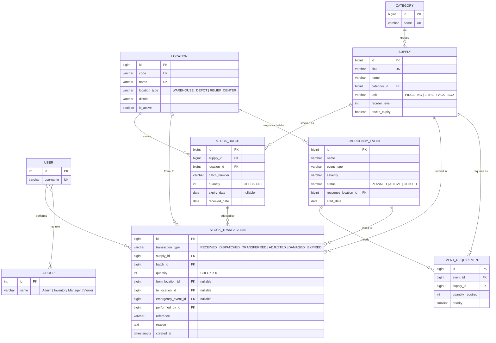

# ERIMS — Entity Relationship Diagram (MVP)

GitHub renders this diagram automatically. To export it as an image for your
report, paste the code block into https://mermaid.live and download PNG/SVG.

## Design notes (useful for your report / viva)

1. **Stock is stored per batch**, not as one number per supply. A batch is a
   quantity of one supply at one location with one expiry date. This makes
   expiry alerts and First-Expiry-First-Out (FEFO) dispatch possible.
2. **Quantities are never edited directly.** All changes go through
   `inventory/services.py`, which writes a `STOCK_TRANSACTION` row every time.
   That table is the audit trail: who moved what, from where, to where, when and why.
3. **Database constraints protect the data even if code has a bug:**
   quantity can never be negative, transaction quantity must be positive,
   every transaction must have at least one location, and a supply can only
   appear once per emergency's requirement list.
4. **Concurrency:** stock operations lock the batch rows they change
   (`SELECT … FOR UPDATE`) inside a database transaction, so two users can't
   dispatch the same stock at the same time.
5. **`PROTECT` foreign keys:** a supply or location that has stock or history
   cannot be deleted — deactivate it with `is_active` instead.
